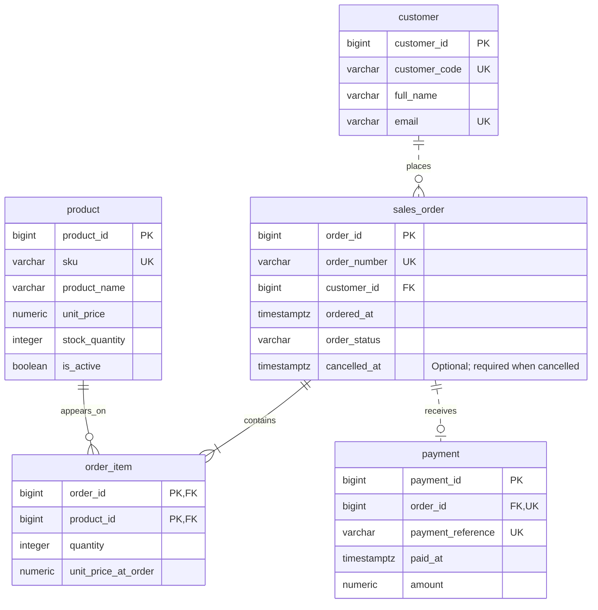

# Harbour Office Supplies: ER diagram

This diagram matches the [data dictionary](Leigh_Olaotan_301920357_P1_Design.md). Its five tables and attributes are implemented in SQL. A transaction must ensure that an order has at least one line. A foreign key cannot enforce that rule alone.

[Open the rendered SVG diagram](Leigh_Olaotan_301920357_P1_ERDiagram.svg). It was exported from the Mermaid source below using Mermaid 11.17.2 and visually tested locally.

`PK` marks a primary-key field, `FK` a foreign key and `UK` a unique candidate key. Both marked fields in `order_item` form one composite primary key; they are not individually unique. Exact lengths, decimal precision and defaults are in the data dictionary.

- Solid lines identify relationships where the parent key forms part of the child primary key (`order_item`). Dashed lines indicate that the child has its own primary key.
- `||` means exactly one, `o|` zero or one, `o{` zero or many, and `|{` one or many.
- A customer may have no orders or several orders. Each order belongs to one customer.
- A successfully placed order contains at least one line. Each line belongs to one order and references one product. A product can appear on many different orders, but only once within one order.
- An order may be unpaid or have one successful full payment. A payment cannot exist without an order.

All attributes are required except `sales_order.cancelled_at`. Its value depends on the order status. Transactions must control stock, fixed historical prices and cancellation. They must also test payment amounts and times. A foreign key does not enforce these rules.

Example: an order for two pen packs and one paper ream has one `sales_order` row and two `order_item` rows. Both lines reference existing products. Recording the full payment adds one `payment` row; it does not add a paid flag to the order.

Diagram notation: [Mermaid ER syntax](https://mermaid.js.org/syntax/entityRelationshipDiagram.html).
