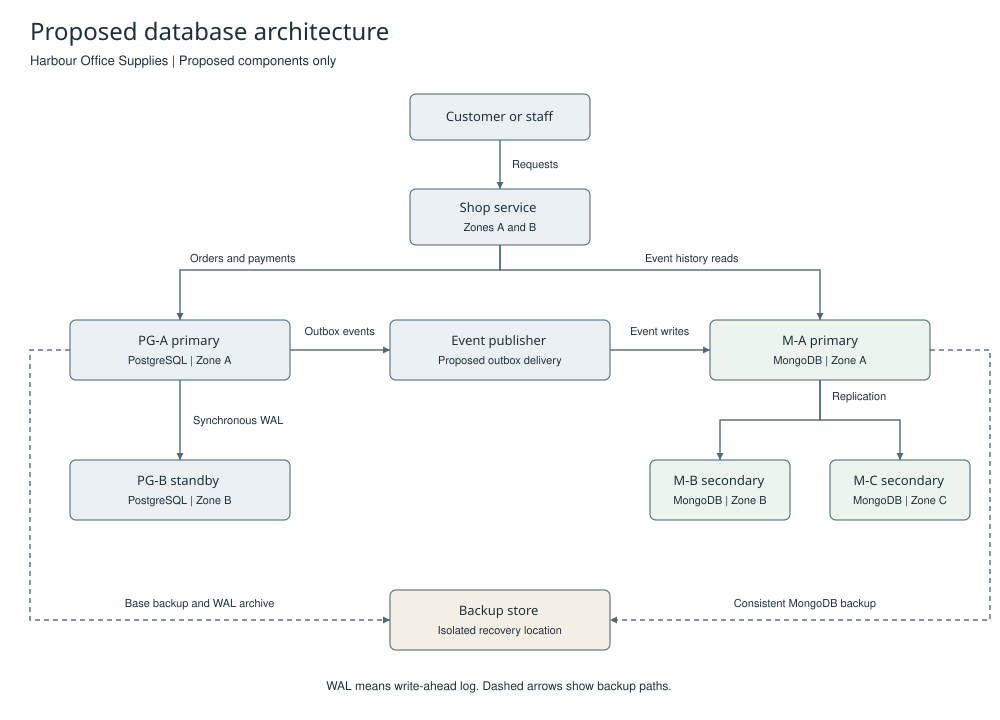

# Proposed Database Architecture

## Purpose and current system

This proposal applies to Harbour Office Supplies, the fictional shop used in P1 to P4. The aim is to keep correct business records and reduce service loss after a server failure.

The current system runs on one computer. PostgreSQL 17.11 stores customer, product, order and payment data. Separate practice databases hold the P1 data, P2 benchmark and P3 transaction tests. MongoDB 7.0.43 stores 14 P1 order events.

There is no shop application, automatic event publisher, replica set or cloud service. The P4 scripts add a fixed set of fictional events. They do not receive live PostgreSQL changes.

## Proposed components

Each zone below represents a separate location for power and network failure. All three zones would be in one cloud region. A failure across the region requires recovery from another location.

| Component | Proposed location | Function |
| --- | --- | --- |
| Shop service | Zones A and B | Receives orders. Calls the PostgreSQL operations. Reads event history. |
| PG-A | Zone A | PostgreSQL primary. Stores the official stock, order and payment records. |
| PG-B | Zone B | Synchronous PostgreSQL standby. Receives the primary's write-ahead log. |
| Event publisher | Zones A or B | Reads saved events from a proposed PostgreSQL outbox. Sends them to MongoDB. |
| M-A | Zone A | Initial MongoDB primary. Stores events and accepts event writes. |
| M-B | Zone B | MongoDB secondary. Stores a full copy and can become primary. |
| M-C | Zone C | MongoDB secondary. Stores a full copy and can become primary. |
| Backup store | Separate recovery location | Stores protected backups and the files necessary for recovery. |

All three MongoDB members would store data and have one vote. No member would be an arbiter. The PostgreSQL pair is separate from this replica set. It does not use the MongoDB election process.

## Proposed data flow

Each component in this diagram is a proposal. The diagram is not evidence of a running service.

WAL means write-ahead log. PostgreSQL records changes in this log. A standby receives these records through streaming replication. A synchronous commit can wait for the standby to save the required log records. [PostgreSQL replication](https://www.postgresql.org/docs/17/warm-standby.html).

Each MongoDB member stores a copy of the same event data. This is replication. It is not sharding, which divides data across shards. [MongoDB replication](https://www.mongodb.com/docs/v7.0/replication/).

## Proposed order and event process

1. The shop service starts a PostgreSQL transaction.
2. The transaction calls the P3 operation for an order, payment or cancellation.
3. The same transaction writes an event into a new outbox table.
4. The transaction commits the business change and outbox event together.
5. The publisher reads committed outbox events.
6. The publisher writes each event to MongoDB with a stable event ID.
7. After MongoDB confirms the write, the publisher records delivery in PostgreSQL.

An outbox is a table of events for delivery. This table and publisher are new design work. They are not present in the submitted P3 or P4 scripts.

A publisher can fail after delivery but before it records delivery. It must then retry with the same event ID. The publisher must compare the content when it finds a duplicate ID. A match means the first delivery succeeded. Different content must cause an error report. The unique index alone does not implement this process.

The publisher must keep the event order for each order number. It must report undelivered events. A scheduled comparison must detect missing or different events. This gives eventual delivery without a transaction that spans both database systems.

## Consistency boundary

PostgreSQL decides whether stock is available, a full payment is valid, or an unpaid order can be cancelled. The P3 row locks and transaction rules still apply.

MongoDB gives event history. The history can lag behind PostgreSQL while the publisher retries. A proposed user interface would show that delay. It would read PostgreSQL before it accepts an order or payment decision.

If MongoDB fails, PostgreSQL can continue to save orders only if the proposed outbox has sufficient storage. The service must stop safely if that storage is exhausted. This behaviour depends on future implementation and tests.

## Implementation limits

Implementation requires new service code, an outbox table, database accounts and recovery controls. Tests must cover repeat delivery and event order. The fixed P4 identifier patterns would need a larger namespace for real traffic.

No replication settings have been changed on the current computer. See the [discussion](Leigh_Olaotan_301920357_P5_DistributedDiscussion.md) for failure cases and the reasons for these choices.
